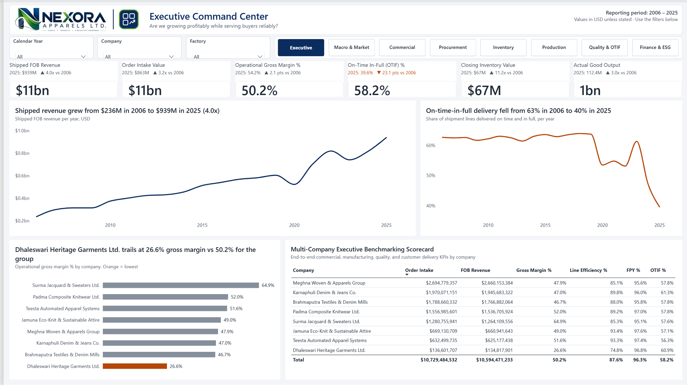
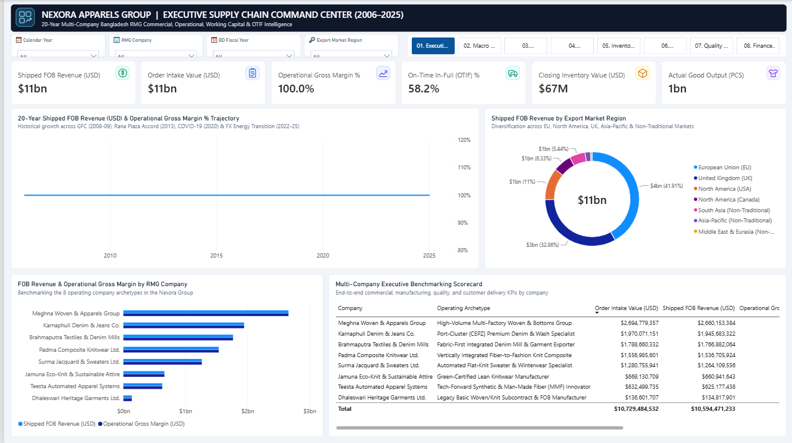
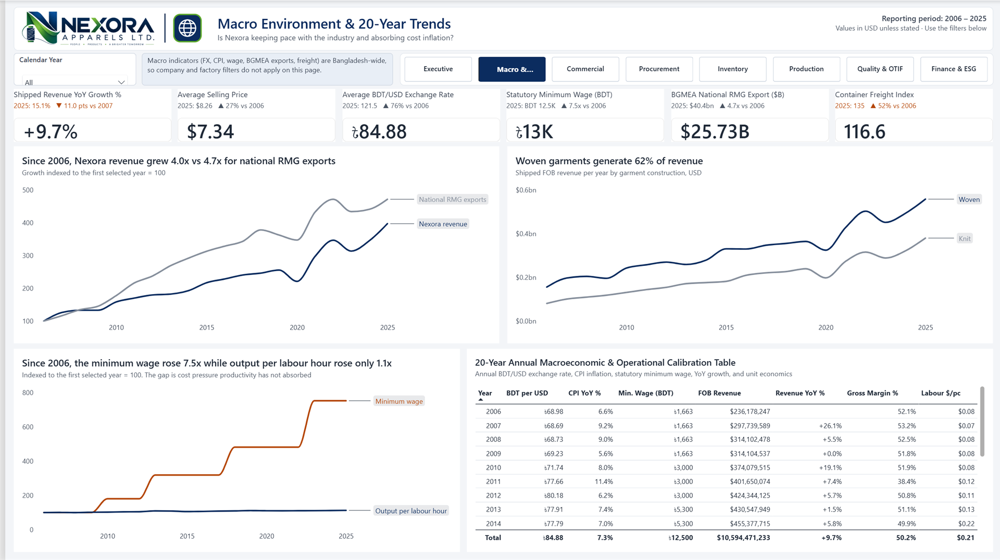
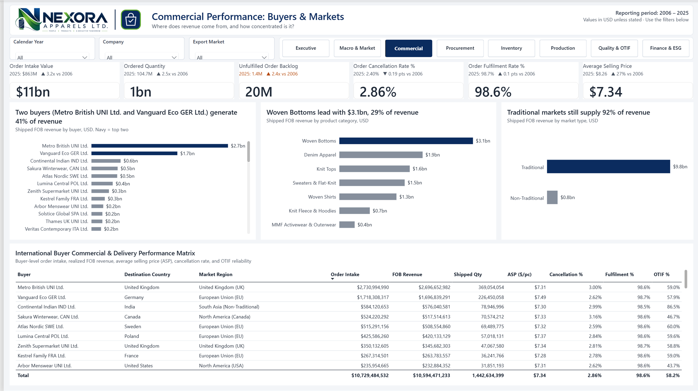
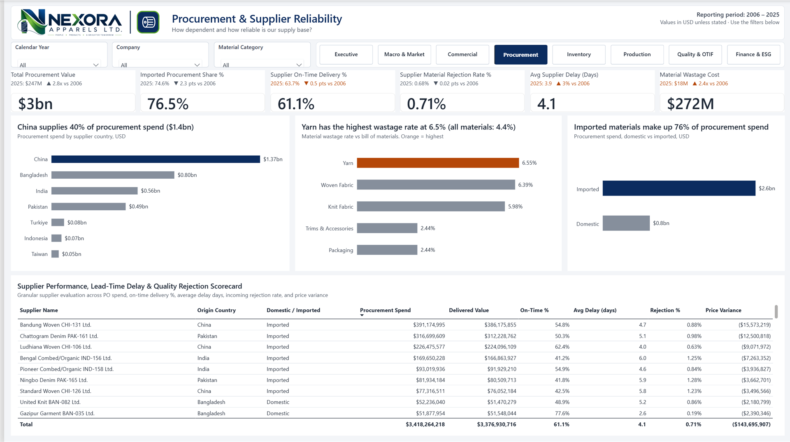
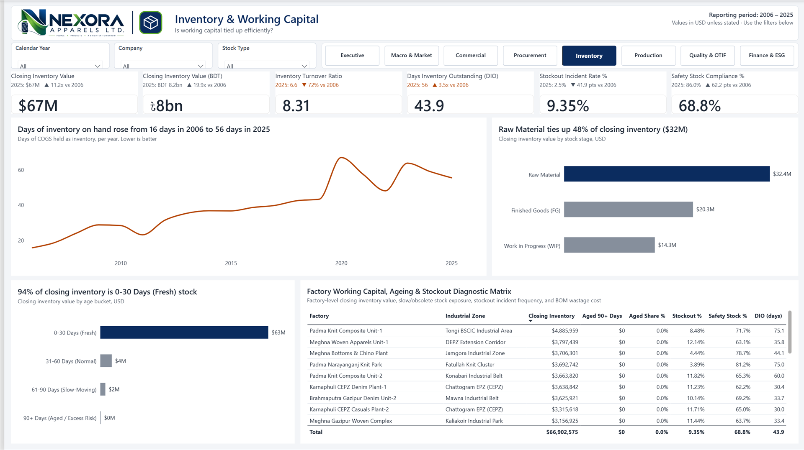
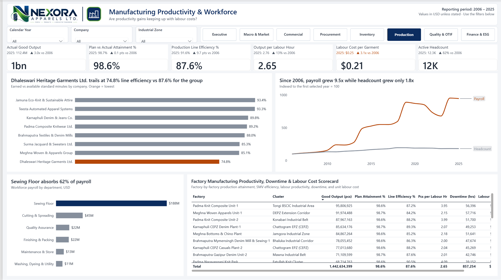
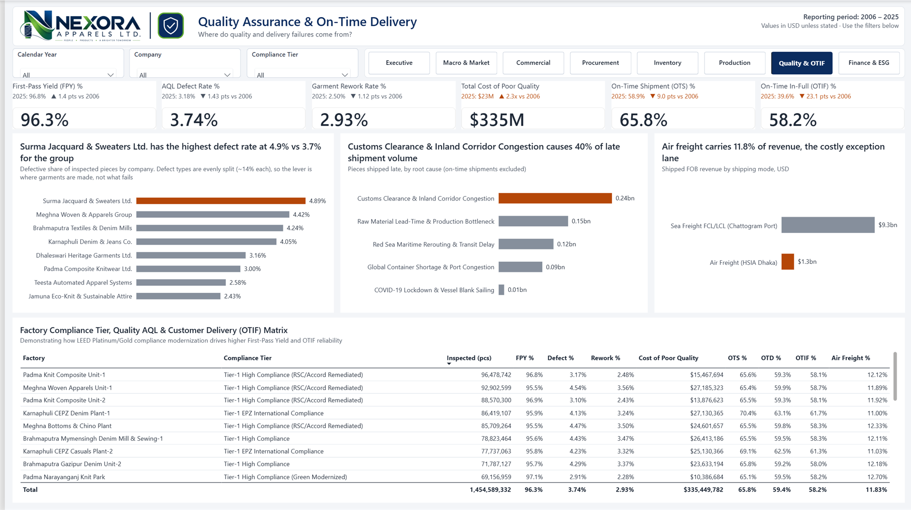
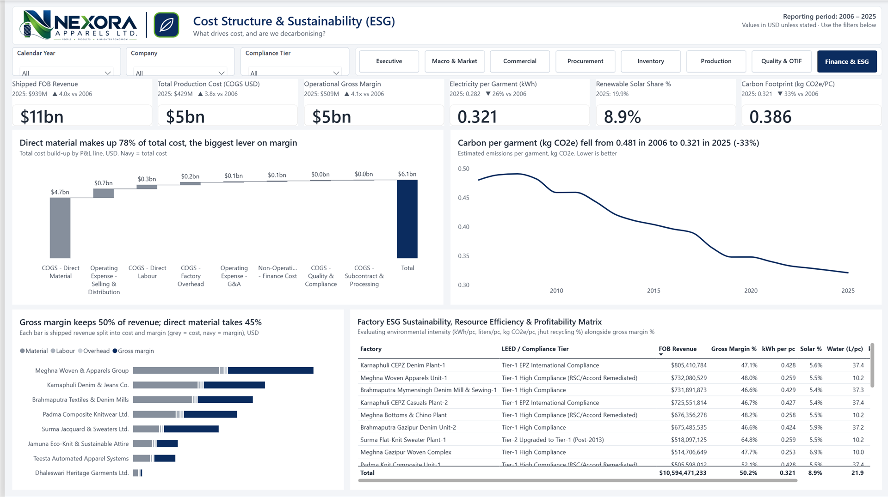

# Nexora Apparels — 20 Years of a Bangladesh Garment Group, Told as One Story in Power BI

> **People · Products · A Brighter Tomorrow** · 8 companies · 26 factories · 52 buyers · 180 suppliers · 2006 – 2025
> A descriptive management dashboard built on Cole Nussbaumer Knaflic's ***Storytelling with Data***: every page answers one question, and every chart title states the answer, recalculated live for whatever you filter.
>
> *All data is synthetic (≈3.04M rows, calibrated to public BGMEA / Bangladesh Bank / BBS benchmarks). Nexora and its companies are fictional.*



---

## The story in one minute

From the top, Nexora looks like a success: **revenue grew 4.0x, from $236M in 2006 to $939M in 2025, at a steady ~50% operational gross margin.** The dashboard is built to look underneath that headline, and it tells a three-act story:

1. **Growth hid a delivery crisis.** On-time-in-full delivery **fell from 63% to 40%**, and days of inventory on hand **rose from 16 to 56**. Nexora also grew more slowly than the industry it sits in (**4.0x vs 4.7x** for national RMG exports), so it has been quietly losing share.
2. **The causes are structural, not seasonal.** The statutory minimum wage rose **7.5x** while output per labour hour rose only **1.1x**. **76%** of materials are imported (40% from China alone), and that dependence has not moved in 20 years. Customs and inland-corridor congestion cause **40%** of late shipment volume.
3. **The levers are specific.** One company (Dhaleswari) trails the group on both margin (**26.6% vs 50.2%**) and line efficiency (**74.8% vs 87.6%**). Another (Surma) has double the defect rate of the best performer. Direct material is **78%** of total cost, so procurement is the biggest margin lever, not the sales office.

> **The big idea:** *Nexora won the volume game. The next decade's margin will be won in the supply chain: delivery reliability, import dependence and productivity per worker.*

---

## Before → after

| Before (as inherited) | After |
|---|---|
|  |  |
| Gross margin showed **100%** (COGS silently blank) · trend chart empty (bars bound to a non-existent role) · 7-slice donut · 4 legends · titles describe the chart, not the finding | Margin **50.2%** and reconciled to the cost ledger · one takeaway per chart, written in the title · grey by default, one highlight colour · KPI cards show "2025 vs 2006" context, orange only when the move is bad |

**Before telling any story, I audited the numbers.** Ten measures were wrong and nine charts silently rendered nothing. The details are in the [case study](documentation/case_study.md#act-1--audit-before-you-narrate). A beautiful dashboard built on a 100% margin is worse than no dashboard.

---

## How to read any page

Every page uses the same layout, so a manager learns to read it once. **Top to bottom: question → scoreboard → answer → evidence.**

| Zone | What it gives you | How to use it |
|---|---|---|
| **Header** | The business question the page answers (under the page title) | Decide whether this page matters for the decision in front of you |
| **KPI cards** | The number, plus a context line: *"2025: 39.6%  ▼ 23.1 pts vs 2006"* | Orange context = it moved the wrong way. Grey = fine or neutral |
| **Chart titles** | **The finding, as a sentence**, e.g. *"Two buyers generate 41% of revenue"* | If you read nothing else, read the titles. They rewrite themselves when you filter |
| **Chart colour** | Grey = context · **navy** = the point · **orange** = the problem | Your eye goes to the coloured bar first. That is deliberate |
| **Bottom table** | The detail behind the story (company, buyer, supplier, factory) | Sort it, scan it, export it |

**Filters:** *Calendar Year* and *Company* follow you across pages (synced). Each page has one extra filter chosen because it filters **every** chart on that page. Pick one year and the KPI context switches to *"vs prior year"*.

---

## Page by page

### 1 · Executive Command Center: *"Are we growing profitably while serving buyers reliably?"*

- **Says:** revenue grew 4.0x at ~50% margin, **but OTIF fell from 63% to 40%**, with the collapse concentrated after 2020. Dhaleswari is the margin outlier at 26.6%.
- **Decision:** where leadership attention goes this quarter: growth or delivery recovery.
- **Design note:** two line charts side by side (navy = healthy, orange = problem) replace a dual-axis combo that mixed $ and % on one chart.

### 2 · Macro & Market: *"Is Nexora keeping pace with the industry and absorbing cost inflation?"*

- **Says:** since 2006 Nexora grew **4.0x vs 4.7x** for national RMG exports. Woven garments generate **62%** of revenue. The minimum wage rose **7.5x** while output per labour hour rose **1.1x**.
- **Decision:** whether productivity investment (automation, lean lines) is now overdue.
- **Design note:** indexing both series to *first year = 100* lets taka wages and pieces-per-hour share one honest axis, with no dual axis.

### 3 · Commercial: *"Where does revenue come from, and how concentrated is it?"*

- **Says:** **two buyers generate 41% of revenue**. Woven Bottoms lead with $3.1bn (29%). Traditional EU/UK/US markets still supply **92%**.
- **Decision:** buyer-concentration risk appetite, and whether to court non-traditional markets.

### 4 · Procurement: *"How dependent and how reliable is our supply base?"*

- **Says:** China supplies **40%** of spend ($1.37bn). Imports are **76%** and flat for 20 years. Yarn wastes **6.5%** vs 4.4% for all materials. Supplier on-time delivery sits at ~61%.
- **Decision:** dual-sourcing and backward-linkage targets to cut lead time.

### 5 · Inventory: *"Is working capital tied up efficiently?"*

- **Says:** days of inventory **rose from 16 to 56**, with a spike in 2020 that never fully unwound. Raw material ties up **48%** of closing stock. Stock is fresh (94% under 30 days), so the issue is *volume*, not *obsolescence*.
- **Decision:** a DIO target and raw-material reorder policy.

### 6 · Production: *"Are productivity gains keeping up with labour costs?"*

- **Says:** payroll grew **9.5x** while headcount grew **1.8x**. Dhaleswari runs at **74.8%** line efficiency vs 87.6% for the group. The sewing floor absorbs 62% of payroll.
- **Decision:** where to deploy industrial-engineering and automation capex first.

### 7 · Quality & OTIF: *"Where do quality and delivery failures come from?"*

- **Says:** Surma has the highest defect rate (**4.9% vs 3.7%** for the group). Defect *types* are evenly split (~14% each), so the lever is **where** garments are made, not **what** fails. Customs and inland congestion cause **40%** of late shipment volume. Air freight carries 11.8% of revenue, the costly exception lane.
- **Design note:** the first version highlighted the "top" defect category. All seven were within 1% of each other, so that highlight was a false signal. I replaced it with defect rate by company, where the 2x spread is real.

### 8 · Finance & ESG: *"What drives cost, and are we decarbonising?"*

- **Says:** direct material is **78%** of total cost, the biggest margin lever. Gross margin keeps 50% of revenue. Carbon per garment **fell 33%** (0.481 → 0.321 kg CO₂e) as solar rose from 0% to ~20%.
- **Design note:** the stacked bar is greys for cost and navy for margin, so each company's bar reads as "how much of every dollar we keep".

---

## How it is built

| Layer | What | Highlights |
|---|---|---|
| **Data** | 22 Parquet tables, ≈3.04M rows, 2006–2025 ([dataset README](rmg_supply_chain_intelligence/README.md)) | 10 conformed dimensions + 12 facts; monthly snapshots for inventory, workforce, ESG, macro |
| **Semantic model** | Star schema, 23 tables, 64 relationships, **215 measures**, TMDL ([data model](documentation/data_model.md)) | Semi-additive inventory/headcount; annualised turnover & DIO; inactive date roles for ship/arrival dates |
| **Storytelling engine** | **8 DAX user-defined functions** (`Nexora.*`) ([how it works](documentation/storytelling_dax.md)) | Every title, KPI context line and highlight colour is one line of DAX calling a shared function |
| **Report** | 8 pages, PBIR format, generated + validated by script ([tools](tools/)) | Brand theme, WCAG-checked colours, alt text on every visual, synced slicers, page navigator |

**Storytelling with Data, applied:**

| Knaflic lesson | In this report |
|---|---|
| Understand the context | Each page header is the management question it answers |
| Choose an appropriate visual | No donuts, no dual axes. Trends are lines, comparisons are sorted bars, unlike units are indexed |
| Eliminate clutter | No chart borders, gridlines, decorative icons, or legends where a direct label works |
| Focus attention | Grey by default; navy for the point, orange for the problem, computed by DAX, so the highlight moves with the data |
| Think like a designer | One grid, one type scale (Segoe UI, ≥10pt), text contrast ≥ 7:1, chart marks ≥ 3:1 |
| Tell a story | Titles are findings, not labels, and recalculate for any filter |

---

## Run it yourself

1. **Regenerate the data** (Parquet is not committed; it is reproducible with a fixed seed):
   ```bash
   cd rmg_supply_chain_intelligence
   pip install -r requirements.txt
   python scripts/export_parquet.py
   ```
2. **Point the model at your copy.** The table sources use an absolute folder path. Find and replace `c:\Users\Junayed\Documents\RMG Company` in `Nexora Apparels Ltd. Dashboard.SemanticModel/definition/tables/*.tmdl` with your clone path.
3. **Open** `Nexora Apparels Ltd. Dashboard.pbip` in Power BI Desktop (a 2025+ build: the model uses DAX user-defined functions, compatibility level 1702) and refresh.
4. **Rebuild the report from code (optional):**
   ```bash
   node tools/build_report.js "Nexora Apparels Ltd. Dashboard.Report"
   node tools/build_storytelling.js "Nexora Apparels Ltd. Dashboard.Report"
   ```

## Repository map

```
├── Nexora Apparels Ltd. Dashboard.pbip          # open this in Power BI Desktop
├── Nexora Apparels Ltd. Dashboard.Report/       # PBIR report: 8 pages, theme, logo, icons
├── Nexora Apparels Ltd. Dashboard.SemanticModel/# TMDL model: tables, relationships, functions, measures
├── tools/                                       # report + storytelling-measure generators (Node.js)
├── documentation/                               # case study, DAX storytelling engine, data model, screenshots
├── dashboard_icons/                             # SVG page and KPI icon set
└── rmg_supply_chain_intelligence/               # synthetic dataset generator, schemas, BigQuery DDL, docs
```

---

**Built by M K Junayed Parves** · Data & BI Analyst · [Portfolio](https://junayedparves.github.io) · [GitHub](https://github.com/JunayedParves)
*Tools: Power BI (PBIP/PBIR/TMDL), DAX incl. user-defined functions, Python (pandas, pyarrow, DuckDB), Node.js, BigQuery DDL.*
