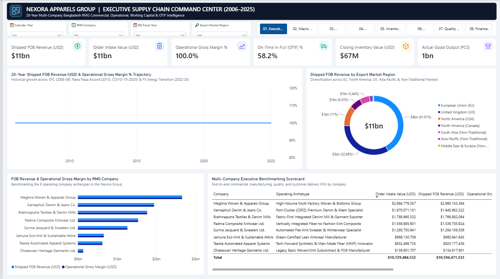

# Case Study: From a Busy Dashboard to a Management Story

This is how the Nexora dashboard went from "eight pages of charts" to "eight answers a manager can act on". It follows the order a data analyst should work in: **audit, then find the story, then design for it.**

---

## Act 1: Audit before you narrate

The inherited report looked finished: a dark header, icons on every KPI, eight pages, donuts and combo charts. The first screenshot showed an **Operational Gross Margin of 100.0%**.

A 100% margin for a garment manufacturer is impossible, so before changing a single colour I queried every headline measure year by year against the raw tables. That audit found:

| # | Problem | Symptom | Root cause | Fix |
|---|---|---|---|---|
| 1 | COGS blank | Gross margin 100% on every page | Filter `income_statement_classification = "COGS"`, but the data holds `"COGS - Direct Material"`, `"COGS - Direct Labour"`, … | `LEFT(…, 4) = "COGS"`. COGS now reconciles: material + labour + overhead = total |
| 2–5 | Direct material, labour, overhead, selling & logistics blank | Cost charts empty; labour $/pc blank | Same label mismatch on `cost_group` | Filter on the actual P&L classification values |
| 6 | COGS (BDT) blank | Taka margin wrong | Same as #1 | Same as #1 |
| 7 | Inventory turnover **166x** | Impossible ratio | 20 years of COGS divided by one month's average inventory | Annualise COGS by months in context → **8.3x** |
| 8 | DIO **2.2 days** | Impossible for a garment maker | Derived from #7 | `365 / annualised turnover` → **44 days** (16 → 56 over 20 years) |
| 9 | Aged 90+ stock blank | Looked like a broken column | Filtered on bucket names `"91-180 Days"` that do not exist | Match the real `"90+ Days…"` bucket; show $0 instead of blank |
| 10 | Air-freight share blank | Column empty | Filter `shipping_mode = "Air"`; data says `"Air Freight (HSIA Dhaka)"` | Prefix match |
| 11 | **9 combo charts drew no bars** | Trend charts showed only a flat line | Bars bound to a role called `ColumnY`, which does not exist (the correct role is `Y`) | Re-bind; found by the PBIR validator, not by eye |

I also checked **which filters actually filter what**, because a slicer that silently does nothing is a credibility risk:

- The **Company** slicer on the macro page did nothing: macro data relates only to dates. I removed it and added a note.
- **Fiscal Year** duplicated Calendar Year. I removed it.
- **Export Market** on the executive page filtered revenue but not costs (costs have no buyer), which made margin by market meaningless. I replaced it with **Factory**, which relates to every fact table.
- **Knit/Woven** on the finance page filtered revenue only (cost and ESG facts have no product). I replaced it with **Compliance Tier**.

> **Lesson:** the most valuable thing an analyst did on this project was not a chart. It was refusing to present a 100% margin.

---

## Act 2: Find the story

With trustworthy numbers, I pulled all 20 years for ~16 core KPIs into one table and looked for the shape of the business:

| Metric | 2006 | 2025 | Change |
|---|---|---|---|
| Shipped revenue | $236M | $939M | **4.0x** |
| Gross margin | 52.1% | 54.2% | stable |
| National RMG exports (BGMEA) | $8.6bn | $40.4bn | **4.7x** |
| **OTIF delivery** | **62.7%** | **39.6%** | **−23 pts** |
| **Days of inventory** | **16** | **56** | **3.5x** |
| Minimum wage (BDT) | 1,663 | 12,500 | **7.5x** |
| Output per labour hour | 2.45 | 2.76 | **1.1x** |
| Payroll / headcount | $3.0M / 6.8k | $28.5M / 12.3k | **9.5x / 1.8x** |
| Imported share of procurement | 76.8% | 74.6% | flat |
| Carbon per garment (kg CO₂e) | 0.481 | 0.321 | **−33%** |

That table *is* the story. Revenue and margin are the comfortable headline. Delivery, inventory and labour productivity are the uncomfortable truth underneath. The big idea in one sentence:

> **Nexora won the volume game; the next decade's margin will be won in the supply chain.**

Each page then became one question in support of that idea, from *"Are we growing profitably while serving buyers reliably?"* to *"What drives cost, and are we decarbonising?"*.

---

## Act 3: Design for the story (Storytelling with Data)

| Before | After | Why (Knaflic) |
|---|---|---|
| Titles named the chart: *"FOB Revenue & Operational Gross Margin by RMG Company"* | Titles state the finding: *"Dhaleswari trails at 26.6% gross margin vs 50.2% for the group"* | Tell the audience what to see; don't make them work for it |
| Every bar in a bright colour | Grey by default, **navy** for the point, **orange** for the problem | Colour is the strongest pre-attentive signal; spend it once |
| Donut charts (7 slices) | Sorted horizontal bars with labels | People compare lengths far better than angles |
| Dual-axis combos ($ bars + % line) | Separate lines, or both series **indexed to 100** | Dual axes invite false comparisons between unrelated scales |
| Legends | Direct labels at the end of each line | Remove the back-and-forth between legend and data |
| Bare KPI numbers ("$11bn") | Number + context line (*"2025: $939M ▲ 4.0x vs 2006"*), orange only if it moved the wrong way | A number without comparison has no meaning |
| Borders, gridlines, icons on every card | Removed | Every element must earn its place on the page |
| Dark, heavy table headers | Light headers, data carries the ink | Emphasise the data, not the container |

### The part that makes it a *dashboard*, not a slide

Static action titles break the moment a manager filters to one company or one year. So every title, every KPI context line and every highlight colour is a **DAX measure** built on eight shared user-defined functions. Select *Surma* and *2023*, and the titles rewrite themselves for Surma in 2023. See [storytelling_dax.md](storytelling_dax.md).

### One judgement call worth showing

The first storytelling pass highlighted the "top defect category" in orange. When I looked closer, all seven categories were within 1% of each other (≈7.8M pieces each). Highlighting one of them would have sent a quality team after a non-problem. The defect rate **by company**, though, ranges from 2.4% to 4.9%, a real 2x gap that holds year after year. The chart now shows that, and its subtitle says plainly that defect *types* are evenly split.

> **Lesson:** emphasis is a claim. Only highlight what the data actually supports.

---

## Accessibility

- Text contrast ≥ 7:1 (ink `#1F2937` on white); chart marks ≥ 3:1, including the grey (`#868F9C`).
- Colour is never the only signal: KPI context uses ▲/▼ arrows as well as orange, and titles state the finding in words.
- Minimum font size 10pt; Segoe UI throughout.
- Alt text on every visual; the logo and page icons are labelled; tab order follows the reading order.
