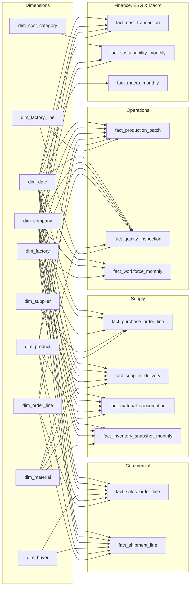

# Semantic Model

A star schema in TMDL: **10 conformed dimensions, 12 fact tables, 1 measure table**, 64 single-direction relationships, **215 measures** and **8 DAX user-defined functions**. Storage mode is Import from Parquet.

## Which filter reaches which fact (why each page has the slicers it has)

| Slicer | Reaches | Does **not** reach | Used on |
|---|---|---|---|
| Calendar Year | every fact | – | all pages (synced) |
| Company | every fact except macro | `fact_macro_monthly` | all pages except Macro (synced) |
| Factory / Industrial Zone / Compliance Tier | every fact except macro | `fact_macro_monthly` | Executive, Production, Quality, Finance & ESG |
| Export Market (buyer) | sales, shipments | costs, production, inventory | Commercial only |
| Material Category | procurement, deliveries, consumption, inventory | sales, costs | Procurement only |
| Stock Type | inventory | everything else | Inventory only |

A slicer that silently fails to filter a visual on its page is a trust problem, so each page-level slicer was chosen to reach every chart on that page.

## Measure design notes

- **Date roles:** each fact has one active date (order, delivery confirmation, inspection, transaction, snapshot month); ship, dispatch and arrival dates are inactive relationships.
- **Semi-additive:** closing inventory, aged stock and headcount take the last snapshot in the filter context, not the sum.
- **Annualised ratios:** inventory turnover = COGS scaled to 12 months / average monthly inventory; DIO = 365 / turnover. Both stay correct for one year or twenty.
- **Display folders:** `01`–`08` business areas, `90. Storytelling` for titles, KPI context lines, highlight colours and index series.
- **Synthetic data:** generated with seed `20261026` by [`rmg_supply_chain_intelligence/scripts`](../rmg_supply_chain_intelligence/scripts); see its [data dictionary](../rmg_supply_chain_intelligence/documentation/data_dictionary.csv) and [validation report](../rmg_supply_chain_intelligence/documentation/validation_report.md).
