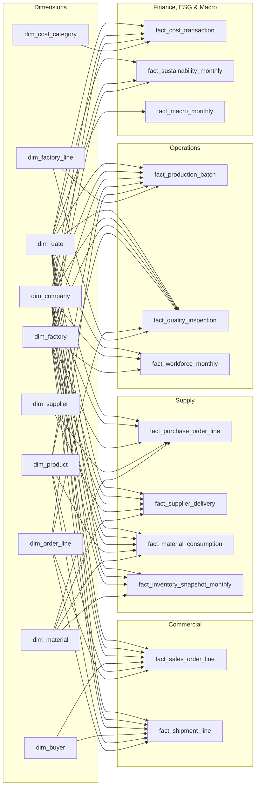

# Semantic Model

A star schema in TMDL: **10 conformed dimensions, 12 fact tables, 1 measure table**, 64 single-direction relationships, **215 measures** and **8 DAX user-defined functions**. Storage mode is Import from Parquet.

## Filters: what each page offers, and what each filter is allowed to change

Every page has four filter slots: **Calendar Year** and **Company** (synced across pages) plus two page filters, each chosen because it reaches every fact on that page. Industrial zone (23 values) and production technology (26) were rejected: they are almost one factory each.

| Page | Filters 3 and 4 |
|---|---|
| Executive | Factory · Compliance Tier |
| Macro & Market | Knit / Woven · *note: national FX, CPI, wage, freight and RMG exports are not affected by filters* |
| Commercial | Export Market · Knit / Woven |
| Procurement | Material Category · Factory |
| Inventory | Stock Type · Material Category |
| Production | Factory · Compliance Tier |
| Quality & OTIF | Compliance Tier · Product Category |
| Finance & ESG | Compliance Tier · Factory |

**Interaction rule** ([tools/build_interactions.js](../tools/build_interactions.js)): a filter narrows the story but never collapses a chart to a single point. A filter does **not** apply to a visual when:

1. the visual is broken down by the filter's own field: Year → the year-trend lines, Company → company ranking and company scorecard, Stock Type → stock-stage bars, and so on;
2. the filter's field nests inside the visual's breakdown, checked against the data: one factory belongs to one company, and one export region belongs to one market type.

So picking 2007 and Dhaleswari keeps the 20-year trend lines (now Dhaleswari's own history), and the ranking and scorecard still compare all companies for 2007. KPI cards and every other chart follow the filters.

## Measure design notes

- **Date roles:** each fact has one active date (order, delivery confirmation, inspection, transaction, snapshot month); ship, dispatch and arrival dates are inactive relationships.
- **Semi-additive:** closing inventory, aged stock and headcount take the last snapshot in the filter context, not the sum.
- **Annualised ratios:** inventory turnover = COGS scaled to 12 months / average monthly inventory; DIO = 365 / turnover. Both stay correct for one year or twenty.
- **Display folders:** `01`–`08` business areas, `90. Storytelling` for titles, KPI context lines, highlight colours and index series.
- **Synthetic data:** generated with seed `20261026` by [`rmg_supply_chain_intelligence/scripts`](../rmg_supply_chain_intelligence/scripts); see its [data dictionary](../rmg_supply_chain_intelligence/documentation/data_dictionary.csv) and [validation report](../rmg_supply_chain_intelligence/documentation/validation_report.md).
