# Relational & Dimensional Data Model Specification

## 1. Architectural Overview

The **20-Year Bangladesh RMG Supply Chain Intelligence** data model is architected as a **multi-fact constellation (conformed star schema)** comprising **10 conformed dimensions** and **12 fact tables** (~3.04 million total records across 2006–2025).

Key design principles:
1. **Strict Separation of Fact Grains**: Transaction-level operational facts (sales orders, PO lines, supplier deliveries, production batches, material consumption, quality inspections, shipment lines) are separated from periodic monthly snapshots (inventory, workforce, sustainability, macroeconomic context) and financial cost postings.
2. **Zero Ambiguous Fact-to-Fact Joins**: Order fulfilment (`fact_sales_order_line`), manufacturing execution (`fact_production_batch`, `fact_quality_inspection`), and export logistics (`fact_shipment_line`) connect cleanly via the conformed bridge dimension `dim_order_line` (`order_line_key`), eliminating many-to-many cardinality traps in Power BI.
3. **Single-Direction Conformed Filtering**: All active relationships flow strictly One-to-Many (`1:*`) from dimensions to facts.

---

## 2. Mermaid Entity-Relationship (ER) Diagram

```mermaid
erDiagram
    dim_date ||--o{ fact_sales_order_line : "order_date_key"
    dim_date ||--o{ fact_purchase_order_line : "po_order_date_key"
    dim_date ||--o{ fact_supplier_delivery : "receipt_date_key"
    dim_date ||--o{ fact_production_batch : "actual_completion_date_key"
    dim_date ||--o{ fact_material_consumption : "consumption_date_key"
    dim_date ||--o{ fact_quality_inspection : "inspection_date_key"
    dim_date ||--o{ fact_shipment_line : "actual_ship_date_key"
    dim_date ||--o{ fact_inventory_snapshot_monthly : "date_key"
    dim_date ||--o{ fact_cost_transaction : "transaction_date_key"
    dim_date ||--o{ fact_workforce_monthly : "date_key"
    dim_date ||--o{ fact_sustainability_monthly : "date_key"
    dim_date ||--o{ fact_macro_monthly : "date_key"

    dim_company ||--o{ dim_factory : "company_key"
    dim_factory ||--o{ dim_factory_line : "factory_key"

    dim_company ||--o{ fact_sales_order_line : "company_key"
    dim_factory ||--o{ fact_sales_order_line : "factory_key"
    dim_buyer ||--o{ fact_sales_order_line : "buyer_key"
    dim_product ||--o{ fact_sales_order_line : "product_key"
    dim_order_line ||--|| fact_sales_order_line : "order_line_key"

    dim_order_line ||--o{ fact_production_batch : "order_line_key"
    dim_order_line ||--o{ fact_quality_inspection : "order_line_key"
    dim_order_line ||--o{ fact_shipment_line : "order_line_key"

    dim_factory ||--o{ fact_production_batch : "factory_key"
    dim_factory_line ||--o{ fact_production_batch : "production_line_key"
    dim_product ||--o{ fact_production_batch : "product_key"

    dim_supplier ||--o{ fact_purchase_order_line : "supplier_key"
    dim_material ||--o{ fact_purchase_order_line : "material_key"
    dim_supplier ||--o{ fact_supplier_delivery : "supplier_key"
    dim_material ||--o{ fact_supplier_delivery : "material_key"
    dim_material ||--o{ fact_material_consumption : "material_key"
    dim_material ||--o{ fact_inventory_snapshot_monthly : "material_key"

    dim_cost_category ||--o{ fact_cost_transaction : "cost_category_key"
    dim_factory ||--o{ fact_cost_transaction : "factory_key"
    dim_factory ||--o{ fact_workforce_monthly : "factory_key"
    dim_factory ||--o{ fact_sustainability_monthly : "factory_key"
```

---

## 3. Table Grain, Keys & Business Definitions

### A. Dimension Tables (10 Tables)

| Table Name | Grain | Primary Key | Foreign Keys | Row Count | Business Definition |
|:---|:---|:---|:---|---:|:---|
| `dim_date` | 1 row per calendar day (2006-01-01 to 2025-12-31) | `date_key` | — | 7,305 | Calendar and Bangladesh fiscal calendar (`FY July–June`), Fridays as factory weekend, Ramadan/Eid windows, and buying seasons. |
| `dim_company` | 1 row per fictional RMG group | `company_key` | — | 8 | Anonymized Bangladesh RMG manufacturing groups spanning Knit Composite, Woven, CEPZ Denim, Eco-Knit, Sweater, MMF, and Legacy CMT. |
| `dim_factory` | 1 row per manufacturing facility | `factory_key` | `company_key` | 26 | Factories across Gazipur, Savar, Ashulia, Narayanganj, Chattogram, Mymensingh, Cumilla, and Dhaka with opening/closure dates. |
| `dim_factory_line` | 1 row per production line | `production_line_key` | `factory_key`, `company_key` | 200 | Individual sewing/knitting lines with shift patterns, operator headcount, and standard monthly capacity. |
| `dim_buyer` | 1 row per international buyer | `buyer_key` | — | 52 | Global fashion brands and retailers across EU, USA, UK, Canada, and Non-Traditional markets (Japan, Australia, India, Turkiye, etc.). |
| `dim_supplier` | 1 row per raw material/trim supplier | `supplier_key` | — | 180 | Domestic backward-linkage mills and international exporters (China, India, Pakistan, Turkiye, Taiwan, Germany, Indonesia). |
| `dim_product` | 1 row per garment style | `product_key` | `primary_material_key` | 125 | Garment styles with Knit/Woven classification, SMV, BOM material consumption per unit, value tier, and introduction/discontinuation dates. |
| `dim_material` | 1 row per raw material / packaging item | `material_key` | — | 64 | Yarn, raw cotton, knit/woven/denim fabrics, ZDHC dyes/chemicals, trims, and packaging items with UOM and standard lead times. |
| `dim_cost_category` | 1 row per standardized expense category | `cost_category_key` | — | 12 | Direct Materials, Trims, Direct Labour, Factory Overhead, Utilities, Maintenance, Quality/Compliance, Inland Logistics, Freight, Admin, Finance, Subcontract. |
| `dim_order_line` | 1 row per customer sales order line | `order_line_key` | `company_key`, `factory_key`, `buyer_key`, `product_key` | 240,000 | Conformed bridge dimension linking sales order lines to production batches, quality inspections, and shipment lines without many-to-many joins. |

### B. Fact Tables (12 Tables)

| Table Name | Grain | Primary Key | Partition Column | Row Count | Business Definition |
|:---|:---|:---|:---|---:|:---|
| `fact_sales_order_line` | 1 row per customer sales order line | `order_line_key` | `order_date` (`event_year`) | 240,000 | Commercial order intake, amended eligible quantities, discounts, USD/BDT values, cancellations, and unfulfilled backlog. |
| `fact_purchase_order_line` | 1 row per supplier PO line | `purchase_order_line_key` | `po_order_date` (`event_year`) | 245,000 | Raw material and trim procurement commitments, unit costs, expected delivery dates, and currency conversion. |
| `fact_supplier_delivery` | 1 row per GRN receipt lot against a PO line | `delivery_key` | `receipt_date` (`event_year`) | 281,781 | Physical material receipts, split deliveries, incoming QC rejections, accepted quantities, and supplier lead-time delays. |
| `fact_production_batch` | 1 row per manufacturing batch | `production_batch_key` | `actual_completion_date` (`event_year`) | 290,415 | Floor execution batches, planned vs. actual dates, gross output, good output, rework, scrap, SMV earned minutes, labour hours, and downtime. |
| `fact_material_consumption` | 1 row per batch x material group consumed | `consumption_key` | `consumption_date` (`event_year`) | 580,830 | Planned BOM material requirements vs. actual material issues and cutting/knitting wastage quantities and costs. |
| `fact_quality_inspection` | 1 row per batch final AQL inspection | `inspection_key` | `inspection_date` (`event_year`) | 290,415 | 100% end-line and pre-shipment AQL audit outcomes, defect categories, first-pass yield, rework, rejections, and quality costs. |
| `fact_shipment_line` | 1 row per export shipment x order line | `shipment_line_key` | `actual_ship_date` (`event_year`) | 259,205 | Factory dispatch, port loading, sea/air mode, vessel arrival, confirmed customer delivery, FOB revenue, freight cost, and delay reasons. |
| `fact_inventory_snapshot_monthly` | 1 row per month x active factory x stocked item | `inventory_snapshot_key` | `snapshot_month_date` (`event_year`) | 255,360 | Reconciled monthly opening, receipts, production additions, consumption, shipments, adjustments, closing stock, ageing, and valuation. |
| `fact_cost_transaction` | 1 row per cost ledger posting / allocation | `cost_transaction_key` | `transaction_date` (`event_year`) | 348,017 | Traceable cost transactions across all 12 expense categories in original currency, USD, and BDT. |
| `fact_workforce_monthly` | 1 row per month x active factory x dept x grade | `workforce_month_key` | `month_start_date` (`event_year`) | 47,880 | Headcount, hires, separations, statutory minimum wage vs. actual average wage, overtime hours, base payroll, allowances, and training. |
| `fact_sustainability_monthly` | 1 row per month x active factory | `sustainability_month_key` | `month_start_date` (`event_year`) | 5,320 | Electricity (grid vs. solar), natural gas, water withdrawal, ETP wastewater treatment, fabric waste recycling, and Scope 1+2 CO2e emissions. |
| `fact_macro_monthly` | 1 row per calendar month (2006-01 to 2025-12) | `macro_month_key` | `month_start_date` (`event_year`) | 240 | Sourced and bounded monthly macro series: BDT/USD exchange rate, CPI inflation, statutory minimum wages, cotton/freight/energy indices, and BGMEA FY exports. |
